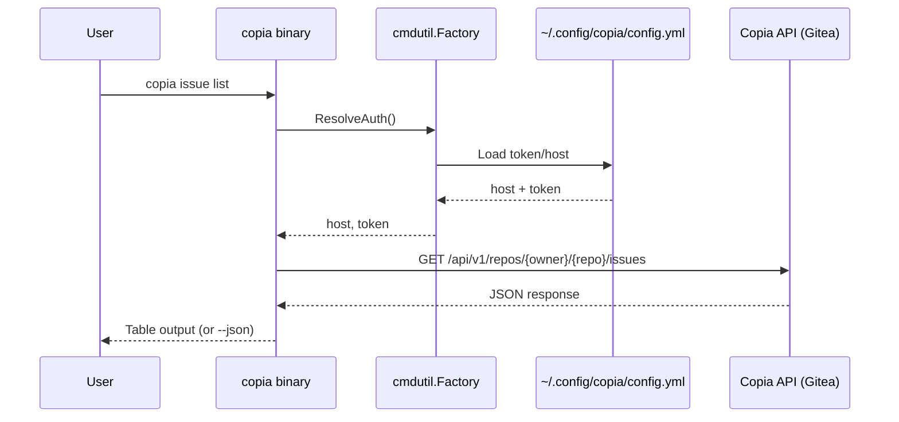

# Codebase Map

> Auto-generated by Cartographer. Last mapped: 2026-04-01T17:19:06Z

## System Overview

```mermaid
graph TB
    subgraph Entrypoint
        main[cmd/copia-cli/main.go]
    end
    subgraph Internal
        copiacmd[copiacmd.Main]
        build[build.Version]
        config[config.Load/Save]
    end
    subgraph Factory
        factory[cmdutil.Factory]
        iostreams[iostreams.IOStreams]
    end
    subgraph Commands
        auth[auth: login/logout/status]
        repo[repo: list/view/clone/create/delete/fork/set-default]
        issue[issue: list/create/view/close/comment/edit/status]
        pr[pr: list/create/status/view/merge/close/review/diff/checkout]
        label[label: list/create]
        release[release: list/create/delete/upload]
        apicmd[api: raw REST request]
        search[search: issues/repos]
        org[org: list/view]
        notification[notification: list/read]
        gpgkey[gpg-key: list/add]
        browse[browse: open repo/issue/PR URL]
        status[status: dashboard across repositories]
        configcmd[config: get/set/list]
        aliascmd[alias: set/list/delete/import]
        completion[completion: bash/zsh/fish/powershell]
    end
    subgraph API
        client[pkg/api/client.go]
        gitea[Gitea SDK]
    end
    subgraph Testing
        httpmock[pkg/httpmock]
        integration[test/integration]
    end

    main --> copiacmd
    copiacmd --> factory
    copiacmd --> build
    copiacmd --> config
    factory --> iostreams
    copiacmd --> auth & repo & issue & pr & label & release & apicmd & search & org & notification & gpgkey & browse & status & configcmd & aliascmd & completion
    auth & repo & issue & pr & label & release & apicmd & search & org & notification & gpgkey & status --> factory
    browse --> factory
    configcmd --> factory
    aliascmd --> factory
    completion --> iostreams
    auth & repo & issue & pr & label & release & apicmd & search & org & notification -.-> client
    client --> gitea
    httpmock -.-> auth & repo & issue & pr & label & release & apicmd & search & org & notification & gpgkey
    integration --> gitea
```



## Directory Structure

```
copia-cli/
├── cmd/copia-cli/main.go              # Entrypoint → copiacmd.Main()
├── internal/
│   ├── build/build.go             # Version/Date injection (ldflags)
│   ├── config/config.go           # YAML config (~/.config/copia/config.yml)
│   ├── docs/markdown.go           # Markdown manual generation (Jekyll)
│   └── copiacmd/root.go           # Root command wiring, Main()
├── pkg/
│   ├── api/client.go              # Gitea SDK wrapper
│   ├── cmd/
│   │   ├── auth/                  # login, logout, status
│   │   ├── repo/                  # list, view, clone, create, delete, fork, setdefault
│   │   ├── issue/                 # list, create, view, close, comment, edit, status
│   │   ├── pr/                    # list, create, status, view, merge, close, review, diff, checkout
│   │   ├── label/                 # list, create
│   │   ├── release/               # list, create, delete, upload
│   │   ├── api/                   # single command: api <path>
│   │   ├── search/                # issues, repos
│   │   ├── org/                   # list, view
│   │   ├── notification/          # list, read
│   │   ├── gpgkey/                # list, add (the gpg-key group)
│   │   ├── browse/                # single command: browse [<number> | <path> | <commit-sha>]
│   │   ├── status/                # single command: status (gh's dashboard)
│   │   ├── config/                # get, set, list
│   │   ├── alias/                 # set, list, delete, import; expand/ (alias expansion), shared/ (name and expansion checks)
│   │   └── completion/            # single command: completion <shell> (bash, zsh, fish, powershell)
│   ├── cmdutil/
│   │   ├── factory.go             # Factory dependency injection
│   │   ├── browser.go             # Browser opener (COPIA_BROWSER, config browser, BROWSER, OS default)
│   │   ├── browsertest/           # Fake browser for --web tests
│   │   ├── web.go                 # --web: RepoWebURL, OpenInBrowser, WarnWebIgnored
│   │   ├── editor.go              # --editor (COPIA_EDITOR, config editor, VISUAL, EDITOR), run without a shell
│   │   ├── editortest/            # Fake editor command for tests
│   │   ├── json.go                # --json field filter, --jq (gojq), --template, PrintJSON
│   │   └── template.go            # --template execution and its gh helpers
│   ├── iostreams/
│   │   ├── iostreams.go           # TTY-aware I/O, TerminalWidth, Test() helper
│   │   └── pager.go               # Pager (COPIA_PAGER, config pager, PAGER), run without a shell
│   └── httpmock/registry.go       # HTTP transport mock for testing
├── test/integration/              # Live API integration tests
├── .github/workflows/             # CI, CodeQL, release, govulncheck, bump-go
├── .devcontainer/                 # Docker Compose-based dev environment
│   ├── compose.yaml               # Sandbox dev service for horde-dev (runs as 1000:100)
│   └── Dockerfile                 # Sandbox dev image with pinned golangci-lint
├── .goreleaser.yml                # Cross-platform release config
├── justfile                       # Command runner (build, test, lint, dev)
├── Dockerfile                     # Go dev image (Go version of go.mod)
├── docker-compose.yml             # Base compose config
└── docker-compose.dev.yaml        # Dev overlay (source mount + caches)
```

## Module Guide

### `cmd/copia-cli/`
**Purpose:** Binary entrypoint — delegates to `copiacmd.Main()`
**Entry point:** `main.go`

### `internal/build/`
**Purpose:** Version and date injection via ldflags at build time
**Entry point:** `build.go`
**Exports:** `var Version`, `var Date`
**Pattern:** `init()` falls back to `debug.ReadBuildInfo()` when `Version == "DEV"`

### `internal/config/`
**Purpose:** YAML config management for multi-host credentials and the settings `output`, `browser`, `pager`, `editor` and `aliases` (top-level keys beside `hosts`)
**Entry point:** `config.go`
**Exports:** `Config`, `HostConfig`, `Option`, `Options`, `Load()`, `Save()`, `DefaultPath()`, `DefaultHost()`, `Get()`, `Set()`
**Pattern:** XDG Base Dir, 0600 permissions, graceful empty-config on missing file

### `internal/docs/`
**Purpose:** Jekyll-compatible markdown generation for the Cobra command tree
**Entry point:** `markdown.go`
**Exports:** `GenMarkdownTreeCustom()`
**Pattern:** Adapted from `github.com/cli/cli/v2/internal/docs`, driven by `script/gen-docs.go`

### `internal/copiacmd/`
**Purpose:** Root command construction and `Main()` entrypoint
**Entry point:** `root.go`
**Exports:** `NewRootCmd(f)`, `NewFactory(ios)`, `Execute(f, args)`, `ShellAliasError`, `Main() int`
**Pattern:** Constructs Factory, reads env vars, registers all command groups; `Execute` expands an alias of the config file before the cobra dispatch when the arguments name no built-in command, and runs a shell alias (`!` prefix) through `sh -c` with the arguments as positional parameters, its exit status becoming the one of `Main`

### `pkg/api/`
**Purpose:** Thin factory for Gitea SDK clients
**Exports:** `NewClientWithHTTP()`
**Pattern:** `NewClientWithHTTP` takes the HTTP client: `cmdutil.NewHTTPClient()` in commands, a custom transport for httpmock testing

### `pkg/cmdutil/`
**Purpose:** Shared dependency container and CLI helpers
**Key files:**
| File | Purpose |
|------|---------|
| `factory.go` | Factory struct with `ResolveAuth()` |
| `json.go` | `JSONFlags`, `AddJSONFlags()`, `PrintJSON()` |
| `httpclient.go` | `NewHTTPClient()`, the client of every command; refuses redirects that change scheme, host or port. `NewDownloadHTTPClient()`, only for the file requests of `release download`: follows https redirects (at most 3) to another host without `Authorization`, `Proxy-Authorization` or `Cookie`, and never sends `Referer`; its refusals are a `RedirectError` naming hosts only |

### `pkg/iostreams/`
**Purpose:** TTY-aware I/O abstraction
**Exports:** `IOStreams`, `System()`, `Test()`
**Pattern:** `Test()` returns `(*IOStreams, stdin, stdout, stderr)` — used in every unit test

### `pkg/httpmock/`
**Purpose:** HTTP transport mock for unit testing
**Exports:** `Registry`, `REST()`, `StringResponse()`, `Verify()`
**Pattern:** Implements `http.RoundTripper`; `Verify(t)` asserts all stubs called

### `pkg/cmd/` (Command Packages)

Every command follows identical structure:

```go
type XxxOptions struct { IO, HTTPClient, Host, Token, Owner, Repo, ... }
func NewCmdXxx(f *cmdutil.Factory) *cobra.Command { ... }
func xxxRun(opts *XxxOptions) error { ... }  // unexported, testable
```

| Group | Subcommands | API Pattern |
|-------|-------------|-------------|
| `auth` | login, logout, status | Raw HTTP (no SDK) |
| `repo` | list, view, clone, create, delete, fork, set-default | Raw HTTP + git exec; `set-default` makes no API call |
| `issue` | list, create, view, close, comment, edit, status | Raw HTTP |
| `pr` | list, create, status, view, merge, close, review, diff, checkout | Raw HTTP + git exec |
| `label` | list, create | Raw HTTP |
| `release` | list, create, delete, upload | Raw HTTP + multipart |
| `api` | none (single command `api <path>`) | Raw HTTP, any method (`-X`; GET default, POST when `-f` is set), path prefixed with `/api/v1` |
| `search` | issues, repos | Raw HTTP |
| `org` | list, view | Raw HTTP |
| `notification` | list, read | Raw HTTP (read: PATCH one thread, PUT with `--all`) |
| `gpg-key` | list, add | Raw HTTP: `GET` and `POST /user/gpg_keys` |
| `browse` | none (single command `browse [<number> \| <path> \| <commit-sha>]`) | URL built client-side, opened with `cmdutil.Browser`; raw HTTP only for the default branch of a path and the last commit of `--commit` |
| `status` | none (single command `status`) | Raw HTTP: the issue search and the notifications |
| `config` | get, set, list | No API call; reads and writes the settings of `config.yml`, `set` validates before it saves |
| `alias` | set, list, delete, import | No API call; reads and writes `aliases` of `config.yml`, `set` and `import` refuse a name of a built-in command |
| `completion` | none (single command `completion <shell>`: bash, zsh, fish, powershell) | No API call; Cobra script generation |

### `test/integration/`
**Purpose:** Live API tests against Copia instance
**Pattern:** `//go:build integration`, env vars for credentials, every run in its own `it-run-*` repository that `TestMain` deletes (`runrepo_test.go`, no build tag)
**Files:** auth, repo, issue, label, PR tests + shared `helpers_test.go`

## Data Flow



## Conventions

- **Naming:** camelCase for Go, kebab-case for flags, lowercase package names
- **Error handling:** `_, _ = fmt.Fprintf()` for I/O writes, `defer func() { _ = resp.Body.Close() }()` for response bodies
- **Output:** `text/tabwriter` for tables, `cmdutil.AddJSONFlags` and `JSONFlags.Print` for `--json`, `--jq` and `--template` (see `docs/cli-patterns.md`)
- **Testing:** TDD — test written before implementation, httpmock + iostreams.Test()
- **Git workflow:** Gitflow, conventional commits, issue-driven branches, PR-only merges

## Gotchas

- **Auth commands use raw HTTP** — not the Gitea SDK, because `gitea.NewClient` tries to connect on init
- **Never build an HTTP client by hand:** use `cmdutil.NewHTTPClient()`; a guard test parses non-test code under `pkg/`, `internal/` and `cmd/` and fails on an `http.Client` literal or `new(http.Client)` outside `pkg/cmdutil/httpclient.go`, and on `http.DefaultClient`, `http.Get`, `Head`, `Post` or `PostForm`, also under an aliased `net/http` import
- **`f.BaseRepo` can be nil** — commands that don't need repo context (auth, repo create) must check before calling
- **Gitea returns 403 (not 401) for invalid tokens** — integration tests use `Contains([]int{401, 403})`
- **PR checkout doesn't use auth** — pure git shell-out, relies on git credential config

## Navigation Guide

**To add a new command group (e.g., `copia org`):**
1. Create `pkg/cmd/org/org.go` (aggregator)
2. Create subcommand dirs: `pkg/cmd/org/list/`, `pkg/cmd/org/view/`
3. Follow Options + NewCmd + Run pattern
4. Register in `internal/copiacmd/root.go`: `cmd.AddCommand(orgCmd.NewCmdOrg(f))`

**To add a subcommand to existing group:**
1. Create dir: `pkg/cmd/issue/reopen/`
2. Create `reopen.go` + `reopen_test.go`
3. Register in `pkg/cmd/issue/issue.go`

**To add a new flag to a command:**
1. Add field to `XxxOptions` struct
2. Bind in `NewCmdXxx`: `cmd.Flags().StringVar(&opts.Field, ...)`
3. Use in `xxxRun(opts)`

**To add integration tests:**
1. Add to `test/integration/` with `//go:build integration` tag
2. Use `loadTestEnv(t)` for credentials
3. Cleanup with `defer`
